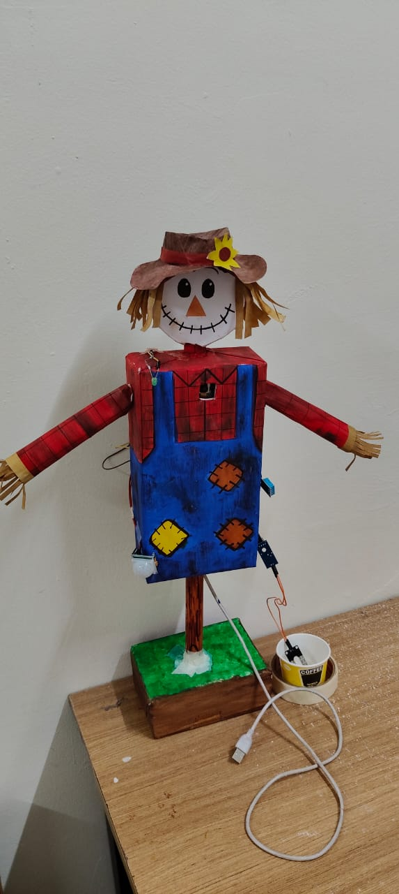
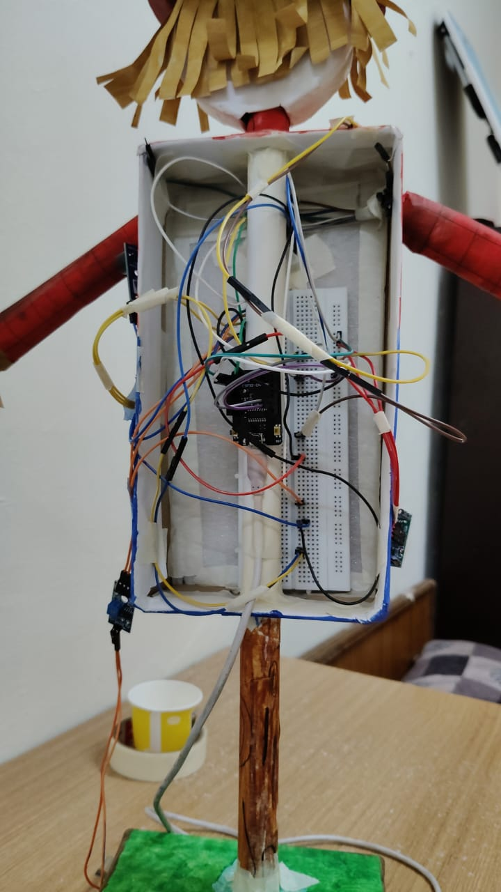

# Solar AI Scarecrow




A low-cost scarecrow that uses an **ESP32-CAM**, a **PIR motion sensor** and a small
**Edge Impulse image-classification model** to detect birds and scare them away with a
buzzer and a blinking LED. It also logs temperature, humidity and soil moisture.

## How it works

1. The PIR sensor waits for motion (after a 30 second warm-up).
2. On motion, the ESP32-CAM takes up to 3 pictures and runs the `bird` / `no_bird` model.
3. If the bird score is at or above the threshold (default `0.60`), the buzzer and LED fire for 3 seconds.
4. Every 10 seconds the DHT11 (temperature, humidity) and soil sensor are read and printed to the Serial Monitor.

Example log from a real run:

```
PIR triggered - motion detected, checking with AI...
   bird: 0.76
   no_bird: 0.24
AI check 1: bird score = 0.76
Bird confirmed (1 hits)
AI RESULT: BIRD/ANIMAL DETECTED
>>> DETERRENT ACTIVATED: Buzzer + LED ON <<<
```

## Hardware

| Part | Notes |
|---|---|
| ESP32-CAM (AI-Thinker) + ESP32-CAM-MB USB base | USB base is used for upload, Serial Monitor and power |
| PIR motion sensor | HC-SR501 type |
| Buzzer module | 3-pin (VCC, I/O, GND), active-low in this build |
| LED + 220 to 470 ohm resistor | |
| DHT11 (or DHT22) | auto-detected |
| Soil moisture sensor (digital output) | AO not used |
| Breadboard + jumper wires | |

## Wiring

| Part | Part pin | ESP32-CAM pin |
|---|---|---|
| PIR | VCC | 5V |
| PIR | OUT | IO13 |
| PIR | GND | GND |
| Buzzer | VCC | 3V3 |
| Buzzer | I/O | IO14 |
| Buzzer | GND | GND |
| LED | long leg (through resistor) | IO12 |
| LED | short leg | GND |
| Soil sensor | VCC | 3V3 |
| Soil sensor | DO | IO15 |
| Soil sensor | GND | GND |
| DHT11 | VCC | 3V3 |
| DHT11 | DATA | IO2 |
| DHT11 | GND | GND |

See [docs/wiring-and-upload-notes.md](docs/wiring-and-upload-notes.md) for the breadboard
layout and the upload procedure.

## Software setup

1. Install the **Arduino IDE** and add ESP32 board support (**esp32 by Espressif**).
2. Install the **DHT sensor library** (Adafruit) and its dependency **Adafruit Unified Sensor**.
3. Train an image-classification model in [Edge Impulse](https://edgeimpulse.com) with two classes,
   `bird` and `no_bird`, then export it as an **Arduino library (.zip)** and install it
   (**Sketch > Include Library > Add .ZIP Library**).
4. Open `scarecrow/scarecrow.ino` and make sure the include line matches your exported library name:
   ```cpp
   #include <bird_detector_inferencing.h>
   ```
5. Select **Tools > Board > ESP32 Arduino > AI Thinker ESP32-CAM**, then pick your COM port.

The trained model is not included in this repository. Export your own from Edge Impulse.

## Uploading

Uploading to the ESP32-CAM needs the board in download mode:

1. **Unplug the IO2 and IO12 wires** (the DHT and LED). They are boot pins and can block the upload.
2. If your camera is on a breadboard, push a jumper from **IO0 to GND**, then press **RST**.
   If it sits on the USB base, hold **BOOT**, tap **RST**, and keep holding BOOT until the percentage appears.
3. Click **Upload**.
4. After "Done uploading", **remove the IO0 jumper**, plug IO2 and IO12 back in, and press **RST**.

**Important:** leave IO0 disconnected when running. If IO0 is tied to GND, the camera fails with
`ERROR: camera capture failed` and the bird score reads `-1.00`.

## Settings you may want to change

All settings are `#define` lines at the top of `scarecrow.ino`.

| Setting | Default | What it does |
|---|---|---|
| `BIRD_THRESHOLD` | `0.60` | Raise to reduce false alarms, lower if birds are missed |
| `HITS_NEEDED` | `1` | Number of positive checks (out of `CHECKS`) before the alarm; use `2` to reduce false alarms |
| `CHECKS` | `3` | How many pictures the AI checks per motion event |
| `BUZZER_ACTIVE_LOW` | `1` | Set `0` if your buzzer sounds when the pin is HIGH |
| `BUZZER_PASSIVE` | `0` | Set `1` for a passive buzzer that needs a tone |
| `USE_DHT` | `1` | Set `0` if no DHT sensor is connected |
| `USE_PIR_GATE` | `1` | `0` makes the AI check continuously, ignoring the PIR |

## Test sketch

`led_buzzer_test/led_buzzer_test.ino` tests only the LED (IO12) and buzzer (IO14), with no camera or
sensors. Use it first to confirm wiring and to find the right buzzer settings.

## Troubleshooting

| Symptom | Likely cause and fix |
|---|---|
| `Wrong boot mode detected (0xb)` on upload | Board not in download mode. Use the BOOT + RST sequence or the IO0-to-GND jumper |
| `No serial data received` on upload | Cable, port or U0R/U0T wiring. Try another USB cable or port, or swap U0R and U0T |
| `camera capture failed`, score `-1.00` | IO0 still connected to GND, loose camera ribbon, or weak power |
| `RESET REASON: BROWNOUT` | Weak USB cable or supply. Use a better cable or a 5V 1A+ supply |
| Buzzer beeps only at power-up | Signal wire not reaching IO14, or wrong buzzer type setting |
| LED never glows | LED reversed, short leg not on GND, or signal wire not on IO12 |
| USB base light turns off | Short circuit between 5V and GND. Unplug and check wiring |

## Power

For a demo, a power bank into the 5V and GND pins works. For solar, use a panel with a charge
module, a battery and a 5V boost converter rated 1A or more. Never connect a panel directly to the board.

## License

MIT. See [LICENSE](LICENSE).
